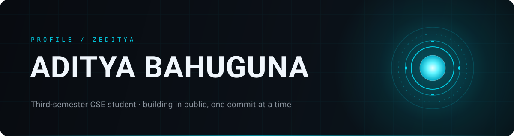
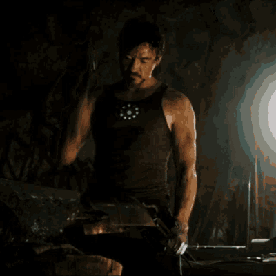

<!-- ══════════════════════════ BANNER ══════════════════════════ -->

  <picture>
    <source media="(prefers-color-scheme: dark)" srcset="assets/banner.svg" />
    <source media="(prefers-color-scheme: light)" srcset="assets/banner-light.svg" />
    
  </picture>

  

  <b>Third-semester CSE undergrad.</b> I'd rather understand a system than memorise its API —
  so I break things on purpose until the abstraction stops being a magic trick.
   
  No 10x claims. Just consistent 1x, compounding.

  
  
  
  

---

## What I actually do

I build in small, finished increments. A half-built idea teaches you nothing;
an ugly finished thing teaches you everything — including where you were wrong.

- **Fundamentals** — DSA in C and C++, complexity, memory. Deliberately boring, because everything else stands on it.
- **Full stack** — HTML, CSS and JavaScript today, Ruby on Rails next. I want to know how a framework *thinks*, not just which command to run.
- **Games** — Godot 4 and GDScript. Also the best excuse I've found to write a colour-theory hack-and-slash.

 

---

## The workshop

The toolbox, honestly labelled. No wall of badges for things I opened once.

**Daily**
 

**Tooling**
 

**Engines & frameworks**
 

**Picking up**
 

 

---

## The boulder

Sisyphus pushes a boulder uphill forever. I work through Striver's A2Z sheet.
His boulder doesn't compile, so I'd argue I have the easier job.

Every solution gets the pattern named, the approach written down, and its time and
space complexity recorded — because past-me is not a reliable narrator. The tracker
in that repo rebuilds itself from git history, so progress is a fact, not a feeling.

**[→ DSA in C++](https://github.com/zeditya/Dsa-cpp)** · `455 problems` · `pattern · approach · complexity`

 

---

## Selected builds

| Project | What it is | Stack |
| :-- | :-- | :-- |
| **[Hue Massacre](https://github.com/zeditya/hue-massacre)** · [play it](https://zeditya.github.io/hue-massacre/) | A colour-theory hack-and-slash where your blade drinks hue, and only a complementary colour can break a knight's oath. Nothing is placed in the editor — the whole game is code. | `Godot 4` `GDScript` |
| **[Odin Rails](https://github.com/zeditya/Odin_RubyOnRails)** | The Odin Project, in public. The README regenerates from git history, so the progress bar can't lie. | `Ruby` `Rails` |
| **[DSA in C++](https://github.com/zeditya/Dsa-cpp)** | Striver's A2Z sheet with reasoning and complexity for every solution, tracked automatically. | `C++` |
| **[Food Court Billing](https://github.com/zeditya/Food_court_management_system)** | Desktop billing app for a campus food court, built to learn GUIs, databases and real data handling. | `Python` |

---

## Receipts

Live numbers. No screenshots, no manual edits — if something here looks quiet, it's because I was quiet.

  <picture>
    <source media="(prefers-color-scheme: dark)" srcset="https://streak-stats.demolab.com?user=zeditya&hide_border=true&background=0D1117&border=0D1117&stroke=1B4A55&ring=00E5FF&fire=00E5FF&currStreakNum=FFFFFF&currStreakLabel=00E5FF&sideNums=F0F6FC&sideLabels=C9D1D9&dates=8B949E" />
    <source media="(prefers-color-scheme: light)" srcset="https://streak-stats.demolab.com?user=zeditya&hide_border=true&background=FFFFFF&border=FFFFFF&stroke=D8DEE4&ring=0891B2&fire=0891B2&currStreakNum=1F2328&currStreakLabel=0891B2&sideNums=1F2328&sideLabels=424A53&dates=6E7781" />
    
  </picture>

  <picture>
    <source media="(prefers-color-scheme: dark)" srcset="https://github-profile-summary-cards.vercel.app/api/cards/stats?username=zeditya&theme=github_dark" />
    <source media="(prefers-color-scheme: light)" srcset="https://github-profile-summary-cards.vercel.app/api/cards/stats?username=zeditya&theme=github" />
    
  </picture>
  <picture>
    <source media="(prefers-color-scheme: dark)" srcset="https://github-profile-summary-cards.vercel.app/api/cards/most-commit-language?username=zeditya&theme=github_dark" />
    <source media="(prefers-color-scheme: light)" srcset="https://github-profile-summary-cards.vercel.app/api/cards/most-commit-language?username=zeditya&theme=github" />
    
  </picture>

  <picture>
    <source media="(prefers-color-scheme: dark)" srcset="https://raw.githubusercontent.com/zeditya/zeditya/output/snake-dark.svg" />
    <source media="(prefers-color-scheme: light)" srcset="https://raw.githubusercontent.com/zeditya/zeditya/output/snake.svg" />
    
  </picture>

---

## How I work

- **Consistency over intensity.** Ninety focused minutes a day beats a heroic all-nighter I need a weekend to recover from.
- **Read the whole error.** The answer is usually in the part I skipped.
- **Explain it or you don't know it.** If I can't teach it to a friend, I'm still guessing.
- **Finish things.** A slightly ugly project that's deployed beats a perfect one stuck on a private branch.

No 3 a.m. genius here. Just a boring, repeatable evening session and a compiler that keeps me honest.

 

---

## Say hi

Best reached by **[email](mailto:adityabahuguna098@gmail.com)** or **[LinkedIn](https://www.linkedin.com/in/aditya-bahuguna-1b1607360)** — I actually reply.

Open to internships, collaborations, and anyone who wants to argue about where the abstraction should live.

  <i>Everything here is a work in progress, including me.</i>

  

