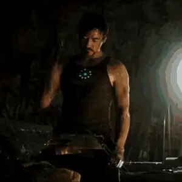

  <picture>
    <source media="(prefers-color-scheme: dark)" srcset="assets/banner.svg" />
    <source media="(prefers-color-scheme: light)" srcset="assets/banner-light.svg" />
    
  </picture>

  

  

  Third semester, three languages, one rule: <b>don't ship what I can't explain.</b>
   
  Most of what's below is C++ fundamentals, Rails in public, and a Godot game that exists because tuning numbers is more fun than sleeping.

---

## What I do

| Area | What that actually looks like |
| :-- | :-- |
| **C / C++** | Pointers, manual allocation, `-Wall -Wextra`, sanitizers, `gdb` before guessing. Working through Striver's A2Z — 455 problems, each one with its approach and complexity written in the header. |
| **Algorithms** | Pattern before code: sliding window, two pointers, binary search on the answer, DP on trees. Every solution gets a one-paragraph note so the idea is rebuildable a month later. |
| **Ruby on Rails** | The Odin Project in public — routing, controllers, ActiveRecord, migrations. That repo's progress bar regenerates from git history, so it can't flatter me. |
| **Godot 4** | Scene tree, signals, per-frame deltas. All code, no editor: [Hue Massacre](https://github.com/zeditya/hue-massacre) is a colour-theory hack-and-slash, [playable here](https://zeditya.github.io/hue-massacre/). |
| **Tooling** | Git branches with messages that explain *why*, shell scripts for anything I'll do twice, and a habit of reading the error instead of skimming it. |

---

## The workshop

Four tools I reach for without opening the docs, and two I'm still earning.

- **`C`** — where I find out what the machine actually does: pointer arithmetic, `malloc`/`free` by hand, buffer overruns I caused on purpose.
- **`C++`** — STL containers and the costs hiding behind them. `vector` growth, `unordered_map` hashing, why `O(n log n)` still loses to a tight loop.
- **`Python`** — the language I prototype in, plus [a billing app for a campus food court](https://github.com/zeditya/Food_court_management_system) that taught me the gap between "it works" and "it's usable".
- **`Ruby on Rails`** — conventions I can now explain rather than obey: the request lifecycle from route to view, migrations as versioned history.
- **`Godot 4 / GDScript`** — one finished game's worth of experience: signals over polling, tuning over feature-adding.
- **`Git` + the shell** — the tools I'd be lost without, which is why I keep learning them properly instead of memorising the six commands I use.

 

---

## The boulder

Sisyphus pushes a boulder uphill forever. I work through Striver's A2Z. His doesn't compile, so I'd argue I have the easier job.

Every solution records its pattern, approach and time/space complexity, and the tracker rebuilds itself from git history — progress is a fact, not a feeling.

**[→ DSA in C++](https://github.com/zeditya/Dsa-cpp)**

 

---

## How I work

Rules I actually follow, not rules I admire:

- **Measure before optimising.** If I can't put a number on the slowness, I'm about to make it slower.
- **Three copies before an abstraction.** Two is a coincidence, three is a pattern. Before that, a function is cheaper than a framework.
- **Reproduce, then fix.** A bug I can't trigger on demand is a bug I haven't understood yet.
- **Complexity in the comment.** Every non-obvious function states its `O()` and why, next to the code that earns it.
- **Tests outlive intentions.** Behaviour that matters gets an assertion, not a promise in a README.
- **Read the source.** Docs describe what someone meant; the source describes what happens.
- **Small commits, honest messages.** The diff says what changed; the message says why it had to.

 

---

## Receipts

Live numbers, no manual edits.

  <picture>
    <source media="(prefers-color-scheme: dark)" srcset="https://streak-stats.demolab.com?user=zeditya&hide_border=true&background=0D1117&border=0D1117&stroke=1B4A55&ring=00E5FF&fire=00E5FF&currStreakNum=FFFFFF&currStreakLabel=00E5FF&sideNums=F0F6FC&sideLabels=C9D1D9&dates=8B949E" />
    <source media="(prefers-color-scheme: light)" srcset="https://streak-stats.demolab.com?user=zeditya&hide_border=true&background=FFFFFF&border=FFFFFF&stroke=D8DEE4&ring=0891B2&fire=0891B2&currStreakNum=1F2328&currStreakLabel=0891B2&sideNums=1F2328&sideLabels=424A53&dates=6E7781" />
    
  </picture>

  <picture>
    <source media="(prefers-color-scheme: dark)" srcset="https://raw.githubusercontent.com/zeditya/zeditya/output/snake-dark.svg" />
    <source media="(prefers-color-scheme: light)" srcset="https://raw.githubusercontent.com/zeditya/zeditya/output/snake.svg" />
    
  </picture>

---

## Connect

  
  
  
  

| Where | What it's for |
| :-- | :-- |
| **[Email](mailto:adityabahuguna098@gmail.com)** | Fastest route. Internships, collaborations, or a question about something in a repo — I answer within a day. |
| **[LinkedIn](https://www.linkedin.com/in/aditya-bahuguna-1b1607360)** | Anything formal: internships, referrals, a recruiter who wants the short version. |
| **[X](https://x.com/zeditya)** | Build logs and half-finished screenshots. Lower stakes than an email. |
| **[Issues](https://github.com/zeditya?tab=repositories)** | Found a bug in one of my repos? Open an issue there — it beats a DM, and I get to fix it in public. |

  <b>Open to</b> backend and C++ internships, Rails or Godot collaborations, and code-review swaps —
  I'll read your PR properly if you tell me where my abstraction is doing nothing.
   
  <i>Everything here is a work in progress, including me.</i>

  

